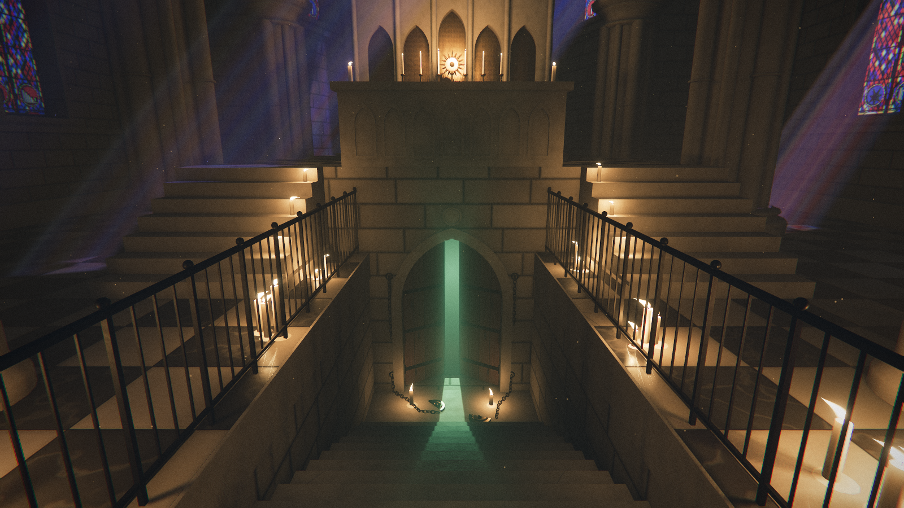

# 시선의 성당 (Claude Fable 5.2)

> 이 저장소의 장면 코드는 Anthropic의 Claude Fable 5.2가 사람의 개입 없이 작성했습니다.
> 실행 준비, 화면 검증, 공개용 정리(이 README, LICENSE, 제3자 고지)는 Claude Opus 5.5가 했습니다.

보고 있는 동안에는 아무것도 변하지 않고, 고개를 돌리거나 눈을 감은 사이에만 바뀌는 1인칭 성당 장면입니다.
3D 모델, 이미지, 소리 파일 없이 three.js와 직접 쓴 셰이더로 형태, 재질, 소리를 실행 중에 만듭니다.



같은 프롬프트로 GPT-6-Astra가 만든 결과와 짝을 이루는 저장소입니다: https://github.com/sidoyu/gaze-cathedral-codex-astra

## English summary

A first-person cathedral that only changes while you are not looking. Turn away or blink, and the statues
move closer, the sealed door below the altar cracks open, the stairs grow by a step and the candles lean
toward the crypt. Everything is generated in code with three.js and hand-written shaders; there are no
model, image or audio files, and the result is a single `index.html`.

- **Who wrote the code:** Claude Fable 5.2 (Anthropic), reasoning effort xhigh, on 2026-11-11, unattended.
- **Prompt:** quoted in full below. It was the first and only message of the session.
- **Time:** about 86 minutes from start to finish (wall clock, including the model's own testing).
- **Conditions:** Claude Code 2.1.322 in headless mode. The repository owner's personal instructions and
  memory were disabled, file writes were sandboxed to the working folder and temporary directories, and no question could be answered during
  the run. A GPT-6-Astra run with the same prompt started at the same moment.
- **Repository preparation:** Claude Opus 5.5 set up the run, verified the result in Chrome on an Apple M4 Pro
  GPU, and wrote this README, the LICENSE and the third-party notice. A person chose the theme and reviewed the results.
- **Run it:** open `index.html` in a desktop browser with WebGL2. Click the eye to begin. Move the mouse to look,
  click or press Space to blink, Esc to pause while the pointer is locked. Arrow keys and touch also work.
- **License:** MIT. three.js r187 (MIT) is bundled; see `THIRD_PARTY_NOTICES.md`. This project is not made or
  endorsed by Anthropic.

## 제작 기록

| 항목 | 내용 |
| --- | --- |
| 모델 | Claude Fable 5.2 (Anthropic) |
| 추론 수준 | xhigh |
| 실행일 | 2026-11-11 |
| 실행 방식 | Claude Code 2.1.322, 터미널 무인 실행 |
| 걸린 시간 | 약 86분(출발부터 끝까지, 모델 자체 시험 포함) |
| 프롬프트 | 세션의 첫 메시지이자 유일한 메시지(아래 원문) |

```text
three.js만으로 1인칭 "시선을 돌린 사이에만 바뀌는 성당" 장면을 단일 HTML로 만들어줘.
- 3D 모델·이미지·오디오 파일 없이 전부 코드로 생성 (효과음·환경음도 합성)
- 플레이어는 제자리에 서서 둘러보기만 한다. 마우스는 시선, 클릭은 눈 깜빡이기
- 핵심 규칙: 보고 있는 동안에는 아무것도 변하지 않는다. 시야 밖에 있거나 눈을 감은 사이에만 성당이 조금씩 바뀐다 (석상이 다가오고, 문틈이 넓어지고, 계단이 한 칸 늘어나고, 촛불이 지하 쪽으로 기운다)
- 변화는 여러 단계에 걸쳐 쌓이고, 대사나 글 없이 "지하에 봉인된 무언가가 깨어나고 있다"는 이야기를 암시한다
- 재미보다 화질 우선: 촛불 조명과 그림자, AO, 먼지 낀 공기의 빛 산란, 스테인드글라스, 색보정을 직접 구현
- 실존 게임·작품의 이름·캐릭터·장소를 쓰지 말 것
- 질문하지 말고 스스로 판단해 끝까지 완성할 것. 조명과 후처리가 갖춰지면 중간 화면을 파일로 저장하고 계속 진행
```

실행 조건은 두 모델에게 같았습니다. 저장소 소유자의 개인 지침과 기억은 꺼 두었고, 파일 쓰기는 작업 폴더와 임시 폴더로 제한했습니다.
이 격리 때문에 모델은 GPU 없는 소프트웨어 렌더로만 자기 화면을 확인할 수 있었습니다.

## 역할

| 누가 | 한 일 |
| --- | --- |
| 저장소 소유자(사람) | 주제 선택, 결과 검토 |
| Claude Fable 5.2 | 장면 코드(`src/`), 빌드·캡처 도구(`tools/`), 결과물 `index.html`, 제작 중 화면(`progress/`) |
| Claude Opus 5.5 | 실행 준비와 격리, 실제 GPU에서 화면 검증, 이 README, LICENSE, 제3자 고지, `.gitignore` |

첫 커밋은 Claude Fable 5.2가 만든 파일을 고치지 않고 담았고, 두 번째 커밋이 공개용 정리입니다.
검증에 쓰려고 받은 브라우저와 npm 캐시는 올리지 않았습니다.

## 실행

`index.html`을 브라우저에서 바로 열면 됩니다. 설치, 서버, 인터넷 연결이 필요 없습니다.
소스를 고친 뒤 다시 만들려면 `tools/`에서 `npm install` 후 `node build.mjs`를 실행합니다.

## 조작

- 눈 모양 아이콘을 클릭해 시작
- 마우스: 시선 / 클릭 또는 Space: 눈 깜빡이기(누르고 있으면 감은 채 유지) / Esc: 마우스 잠금이 걸린 상태에서 멈춤
- 방향키, 터치 드래그와 탭도 받습니다
- 13~20초 동안 깜빡이지 않으면 시야가 흐려지다 저절로 깜빡입니다

## 변하는 것

아래는 Claude Fable 5.2가 완료 보고에서 밝힌 설계입니다. 실제 GPU 검증에서는 문이 갈라지며 빛이 새는 것,
계단이 늘어 문이 깊어지는 것, 석상이 시야 가장자리까지 다가오는 것, 장미창의 눈을 화면으로 확인했습니다.

- 석상 6구: 기도하다가 고개를 지하 쪽으로 돌리고, 내려와 다가오고, 끝내 열린 문을 향해 손을 뻗습니다
- 지하 문: 봉인과 사슬이 걸린 상태에서 7단계로 벌어지며, 틈으로 빛이 새고 사슬이 끊어집니다
- 계단: 한 칸씩 늘어나 문이 그만큼 더 깊어집니다
- 촛불: 불꽃이 문 쪽으로 눕고, 서쪽 끝부터 꺼집니다
- 스테인드글라스의 문양, 장미창의 눈, 지하에서 들리는 숨소리와 심장박동

## 라이선스와 고지

- 이 저장소의 코드는 [MIT 라이선스](LICENSE)를 따릅니다.
- `index.html`에는 [three.js](https://github.com/mrdoob/three.js) r187(MIT)이 라이선스 주석 없이 묶여 있습니다.
  라이선스 전문은 [THIRD_PARTY_NOTICES.md](THIRD_PARTY_NOTICES.md)에 있으며, `index.html`만 따로 배포할 때도 함께 제공해야 합니다.
- 이 프로젝트는 Anthropic이 만들거나 보증한 것이 아닙니다. Claude와 Fable은 제작에 쓴 모델을 밝히려고 적은 이름입니다.
